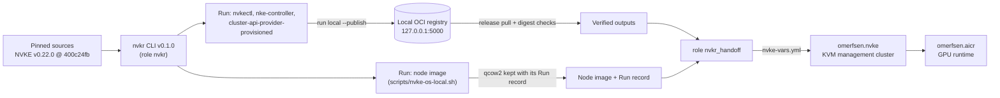

# How it works

NVIDIA Kubernetes Recipes (NVKR) turns pinned source into NVKE artifacts and
records which inputs produced each one. Its lifecycle is Definition → Plan →
Run → Release: a Definition names the outputs, catalogs pin every source,
tool and image, an Environment says where to run and publish, and a Run builds
them in pinned containers. NVKR does not install anything; that is
omerfsen.nvke's job. This collection runs NVKR on one Linux host and hands its
outputs to omerfsen.nvke.



## The roles

| Role | Does |
|---|---|
| `nvkr` | Packages, Docker (only if missing), the user's docker and kvm groups, a `docker-container` Buildx builder on a pinned BuildKit, the exact Go of the release (checksum verified), the NVKR checkout (a moved tag fails the run) and `GOTOOLCHAIN=local make build`. The CLI must report `nvkr version v0.1.0 (5163d525)`. |
| `nvkr_build` | The local registry, then NVKR Runs: `hello` (the quickstart), `components` (nvkectl and the two seed-cluster images) and `node_image`; `verify` pulls a release's outputs back and checks them. `main` does all of it for NVKE. |
| `nvkr_handoff` | Turns the verified outputs and the node image into what omerfsen.nvke takes, and writes a vars file for it. |

## Runs and attempts

Every Run is an NVKR *attempt*, and NVKR never reuses an attempt name: a failed
or interrupted attempt stays on disk as a record. The role names each attempt
`<input set>-<12 hex of the rendered inputs>-<suffix>`:

- Same inputs, same name. A completed attempt is not run again, which is what
  makes a rerun report `changed=0`.
- Changed inputs (a new Environment, an NVKR bump) give a new name and a new Run.
- A failed attempt stops the play with its status. Set
  `nvkr_build_attempt_suffixes: {<input set>: "02"}` to start a new one for that
  Run only, keeping the failed one for diagnosis.

Each Run is started as `systemd-run --scope -p CPUAccounting=yes -- runuser -u
<nvkr_user> -- nvkr run local ...`. NVKR's admission for VM builds reads
`cpu.max` in every cgroup from the process to the root, and fails where the cpu
controller is off, as in the `app.slice` of a systemd user manager (tmux,
desktop terminals). NVKR `main` accepts that case (PR #237), v0.1.0 does not.

## The three Runs

**hello** is NVKR's own quickstart example (`demos/quickstart`), set up the way
`demos/demo-local.sh` does it: a tiny Git repository with tags `v1.0.0` and
`v1.1.0` and fixed dates, the catalog pins one tag, one Run builds the script in
a pinned Alpine container, records an SBOM and, here, publishes it.

**components** is a Definition over NVKR's `inputs/catalogs/nvke/release`
catalog with three outputs: `nvkectl` (executable), `nvke-controller` and
`cluster-api-provider-provisioned` (OCI images), all built from NVKE source at
the pinned commit. The Environment is NVKR's own local NVKE example
(`docs/examples/nvke-tutorial/environment-local.yaml`) pointed at the local
registry, with dry-run signing.

**node_image** runs NVKR's maintained local route unchanged,
`scripts/nvke-os-local.sh <attempt> <jobs>`, for the host's architecture:

1. builds the Packer toolchain image from its source lock
   (`toolchains/nvkr-packer`), through the Buildx builder above;
2. freezes the observed image ID into the attempt's inputs (NVKR keeps no
   stable pin for it: rebuilds did not reproduce IDs upstream);
3. runs the maintained diagnostics Definition (`os-amd64.yaml`): agent,
   Calico, OVN, kubeadm distribution, SPIRE agent, patched Ubuntu 26.04.1
   installer ISO, image inputs, and NVKE's own Packer project in QEMU/KVM.

The result is one plain QCOW2 under `.nvkr/runs/<attempt>/outputs/`, with its
digest in the Run record. NVKR does not publish disks from a local Run.

## What is checked, and what is not

| Check | Where |
|---|---|
| The NVKR tag resolves to the pinned commit; the CLI reports that version and commit | `nvkr` |
| The release's Go is the installed Go | `nvkr` |
| A Run completed every required output, lane `unqualified-local-execution` | `nvkr_build` |
| The release reference is digest-pinned | `nvkr_build` |
| Every blob of every `*.oci.tar` image the node-image Run produced (the OVN image baked into the disk; images inside the other packages are not opened) hashes to its name, when the Run is first checked | `nvkr_build` node_image |
| The release metadata validates; every output has the digest its Run observed | `nvkr_build` verify |
| `release pull` checks each payload against the metadata | `nvkr_build` verify |
| Executable files hash to the release's build subjects; an OCI layout holds the output's manifest | `nvkr_build` verify |
| nvkectl reports the NVKE version and commit omerfsen.nvke pins | `nvkr_handoff` |
| The node image copy hashes to the digest its Run observed | `nvkr_handoff` |
| The seed-image archives are made from the verified layouts and name the manifest the verify step checked; the archive is not re-hashed on later runs | `nvkr_handoff` |

Not checked: signatures. A local Run is unsigned (`signing.mode: dry-run`), and
`nvkr release verify` accepts only the `pipeline-attested` lane, the keyless
signatures of NVKR's generated GitHub Actions workflow. Digest checks prove the
bytes are the ones NVKR built and recorded on this host; they do not prove who
built them. See the roadmap for `run qualify-local` (local keys) and the
hosted pipeline.

## The handoff

omerfsen.nvke normally builds nvkectl and the two seed-cluster images on its
bootstrap VM and the node image with Packer on the hypervisor. With its
prebuilt-artifact options it takes them instead:

| omerfsen.nvke variable | Set to |
|---|---|
| `node_image_file` | The node image copied to `/var/lib/libvirt/images/<output>-nvkr-<12 hex>.qcow2`, so libvirt can read it |
| `nvke_nvkectl_file` | The verified nvkectl |
| `nvke_controller_image_archive`, `nvke_provisioned_image_archive` | OCI archives for `nerdctl load` |
| `nvke_controller_image`, `nvke_provisioned_image` | The references they load as, `nvkr.local/nvke/<name>:nvkr-<12 hex>` |
| `nvke_cni_version` | The OVN-Kubernetes version the node image stages, from the `ovn-kubernetes` pin in NVKR's node-image catalog lock: `1.4.0` for NVKR v0.1.0 |

NVKR v0.1.0's node-image catalogs build upstream OVN-Kubernetes v1.4.0
(`ovn-kubernetes/ovn-kubernetes` at `d6a3812d`). NVKE v0.22.0's own Packer image
stages NVIDIA's OVN-Kubernetes 2.4.2, the version NVKE pins. NVKR has NVIDIA OVN
only as a candidate overlay bound to its ARM64 nightly catalogs, and its local
wrapper takes no extra overlays, so this cluster runs upstream OVN-Kubernetes
1.4.0: the combination NVKR's own NVKE demo calls its matched upstream
alternative, not one NVKE v0.22.0 lists as supported.

The image archives are made the way NVKR's own NVKE demo makes them: the
verified OCI layout, with one `org.opencontainers.image.ref.name` annotation
added to its index so containerd names the image, packed as a tar. The image
bytes are not touched; the manifest digest is checked against the release.

## On disk

```text
/var/lib/nvkr/
├── go-1.27.3/                 Go for NVKR
├── src/nvkr-v0.1.0/           NVKR checkout and bin/nvkr
│   └── .nvkr/
│       ├── omerfsen/          Definitions and Environments this collection writes
│       ├── inputs/<attempt>/  frozen inputs of node-image attempts
│       └── runs/<attempt>/    Run records, packages, outputs/*.qcow2
├── registry/                  local registry storage
├── verified/<release>/<output>/  pulled and checked outputs
├── handoff/                   image archives and nvke-vars.yml
├── logs/<attempt>.log         one log per Run
└── cache/                     Go caches
```
